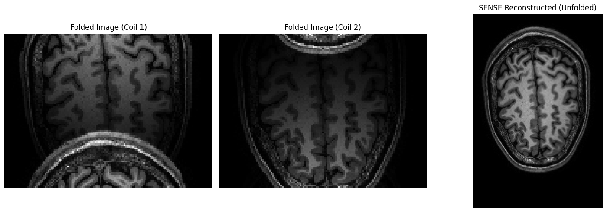
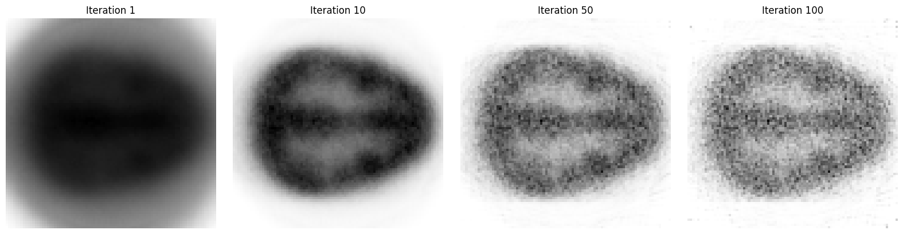

# Medical Image Reconstruction

**Three imaging modalities. Three approaches to recovering an image from measurements.**

Python coursework exploring analytical CT reconstruction, Fourier-based MRI reconstruction and statistical PET reconstruction. Developed jointly in a pair as part of **EEN180 at Chalmers University of Technology**.

The projects connect the measurement model to the reconstructed image: how projection sampling affects CT, how coil sensitivities help unfold MRI, and how iteration count affects noise in PET.

| Project | Implemented work | Main question |
| :--- | :--- | :--- |
| [CT reconstruction](ct/README.md) | Back-projection, FFT-based ramp filtering, windowing experiments | How do projection count and filtering change image quality? |
| [MRI reconstruction](mri/README.md) | Inverse FFT, coil combination, sensitivity correction, SENSE with acceleration factor 2 | How can multiple coils recover a full field of view from undersampled data? |
| [PET reconstruction](pet/README.md) | System-matrix construction, least-squares reconstruction, MLEM; library FBP baseline | How does iterative reconstruction balance structure recovery and noise amplification? |

## Selected results

### CT: reconstructing from projections


Saved reconstructions using 6, 12, 30, 60 and 180 projections. The notebook implements the back-projection and filtering operations directly with NumPy.

### MRI: unfolding undersampled images



Two folded coil images are combined using sensitivity information and pixel-wise least-squares solutions to recover the full image extent.

### PET: following the iterations



The saved sequence illustrates the trade-off between recovering structure and amplifying noise as MLEM progresses. A particular optimal stopping iteration is not claimed here; see the [PET review notes](docs/REVIEW_NOTES.md#pet).

*Figures are extracted from the supplied coursework notebooks. They are qualitative examples, not independently validated performance benchmarks.*

## Explore the notebooks

| Folder | Notebook | Local input |
| :--- | :--- | :--- |
| `ct/` | [ct_reconstruction.ipynb](ct/ct_reconstruction.ipynb) | `CTdata.mat` |
| `mri/` | [mri_reconstruction.ipynb](mri/mri_reconstruction.ipynb) | `MRIdata.mat` |
| `pet/` | [pet_reconstruction.ipynb](pet/pet_reconstruction.ipynb) | `PETdata.mat` |

The notebooks include code, derivations, written discussion and saved figures. You can inspect their saved results without the datasets or a local Python installation.

## Run locally

Use Python 3.11 or 3.12. From the project folder:

```bash
python -m venv .venv
```

Activate the environment:

```powershell
# Windows PowerShell
.venv\Scripts\Activate.ps1
```

```bash
# macOS / Linux
source .venv/bin/activate
```

Then install the dependencies and launch Jupyter:

```bash
python -m pip install -r requirements.txt
python -m jupyter lab
```

Place each `.mat` file beside its corresponding notebook, open the notebook, and run its cells in order. See [data setup](DATA.md) for the expected variables. The PET system-matrix construction and dense least-squares solves are computationally expensive; read its README before running all cells.

## Tools and skills

- **Python, NumPy and SciPy:** numerical methods, array operations, Fourier transforms and MATLAB data loading.
- **Matplotlib and Jupyter:** visual comparison and reproducible analysis workflows.
- **NiBabel:** MRI magnitude-volume export to NIfTI.
- **scikit-image:** Radon projections for the PET system matrix and a filtered-back-projection baseline.
- **Inverse problems:** sampling, conditioning, sensitivity weighting and iterative estimation.

## Scope and provenance

This is an educational portfolio of coursework implementations. Some exploratory sections need further technical revision; [review and validation notes](docs/REVIEW_NOTES.md) distinguish demonstrated methods from unresolved issues. The notes also document the limited changes made when preparing the portfolio.

**Contribution:** Neo Barrdahl ([Nero-Vanetti](https://github.com/Nero-Vanetti)) and a project partner worked together on all code. The work is presented as a joint contribution, not as individually authored implementations. Assignment prompts, starter material and supplied datasets originate from the course.

Dataset files are not redistributed in this repository. No open-source licence is assigned to the mixed course and jointly authored material in this edition. See [credits](CREDITS.md).
