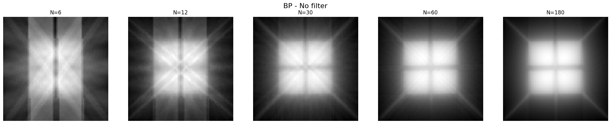
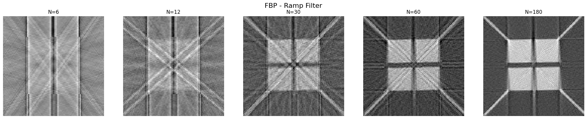

# CT Reconstruction

**From parallel-beam sinograms to cross-sectional images.**

This project implements back-projection and frequency-domain filtered back-projection in Python, then explores how projection count and filtering affect the reconstructed image.

[Open the notebook](ct_reconstruction.ipynb) · [All projects](../README.md)

## The problem

A sinogram contains line-integral measurements of an object at different angles. Reconstruction maps these measurements back to a spatial image. Summing unfiltered back-projections produces a blurred estimate; filtering the projections before back-projecting helps recover edges.

## Methods

| Component | Implementation |
| :--- | :--- |
| Back-projection | Coordinate mapping, nearest-bin sampling and angular summation |
| Ramp-filtered back-projection | FFT along the detector axis, multiplication by `abs(fftfreq(L))`, inverse FFT and back-projection |
| Sampling study | Reconstructions using 6, 12, 30, 60 and 180 selected views |
| Additional experiments | Hamming-window variants, an interpolation-based reconstruction and larger supplied sinograms |

The core CT reconstruction uses NumPy operations rather than `radon` or `iradon` reconstruction routines. The scaling convention follows the supplied assignment.

## Results

**Unfiltered back-projection**

**Ramp-filtered back-projection**

These saved plots show the main qualitative effect: filtering improves edge definition, while sparse angular sampling produces prominent streaks. Images use their plotted display scaling; this is not a calibrated comparison of absolute attenuation values.

## Run

Install the [shared requirements](../requirements.txt), put `CTdata.mat` in this folder and open `ct_reconstruction.ipynb` in Jupyter. Run cells in order.

Inputs are `g` (144 × 180), `g2` (1095 × 180) and `g3` (895 × 360). The first sinogram reconstructs to 100 × 100 pixels.

## Interpretation and limitations

The coursework contains exploratory Hamming and “CBP” sections that should not be treated as verified implementations of standard windowed or spatial-convolution reconstruction. In particular, the function labelled CBP still filters with FFT multiplication. The `g2` 360-view example repeats existing columns rather than adding measurements. These sections are retained for transparency and explained in the [review notes](../docs/REVIEW_NOTES.md#ct).

**Joint work:** Neo Barrdahl and a project partner developed all code together for EEN180, Chalmers University of Technology.
