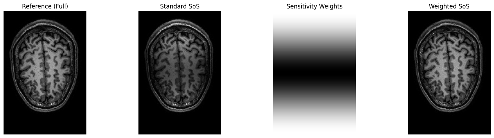

# MRI Reconstruction

**Recovering images from k-space and using coil sensitivities to unfold aliasing.**

This project follows MRI reconstruction from a fully sampled inverse Fourier transform to multi-coil combination and SENSE reconstruction with acceleration factor 2.

[Open the notebook](mri_reconstruction.ipynb) · [All projects](../README.md)

## The problem

MRI measures spatial-frequency information in k-space. Skipping every second line reduces the sampled field of view and creates overlapping anatomy in the reconstructed coil images. Multiple receiver coils provide different sensitivity profiles that can be used to separate those overlapping contributions.

## Reconstruction workflow

1. Calculate field of view from image dimensions and voxel spacing.
2. Reconstruct each slice using a centred 2D inverse FFT.
3. Combine coil images using root-sum-of-squares.
4. Normalize the combined image by the root-sum-of-squares of the sensitivity maps.
5. Reconstruct undersampled coil images and unfold them using pixel-wise least-squares solutions.
6. Export magnitude volumes as NIfTI files for inspection.

The Fourier transforms operate along the first two axes only. Slices and coils are not Fourier-transformed together.

## Results

### Coil combination

Sensitivity normalization compensates for the spatial intensity variation visible in the standard coil combination.

### SENSE unfolding

For each folded location, the implementation builds a sensitivity matrix for the two corresponding full-image positions and solves the local system with `numpy.linalg.lstsq`. The saved result recovers the full image extent, with residual artifacts still visible.

## Run

Install the [shared requirements](../requirements.txt), put `MRIdata.mat` in this folder and open `mri_reconstruction.ipynb` in Jupyter. Run cells in order.

| Input | Shape |
| :--- | :--- |
| Fully sampled k-space | 192 × 129 × 192 |
| Two-coil k-space / sensitivity maps | 192 × 129 × 192 × 2 |
| Undersampled two-coil k-space | 96 × 129 × 192 × 2 |

The dataset is approximately 293 MiB. Reconstructing full volumes requires additional memory. NIfTI exports and generated slice images are ignored by Git.

## Interpretation and limitations

The SENSE implementation is specific to factor-2 undersampling and the supplied indexing convention. There is no quantitative SNR or artifact benchmark here. The NIfTI export sets voxel sizes in the header but starts with an identity affine; anatomical orientation and consistency of the spatial transform require further review. See [technical notes](../docs/REVIEW_NOTES.md#mri).

**Joint work:** Neo Barrdahl and a project partner developed all code together for EEN180, Chalmers University of Technology.
