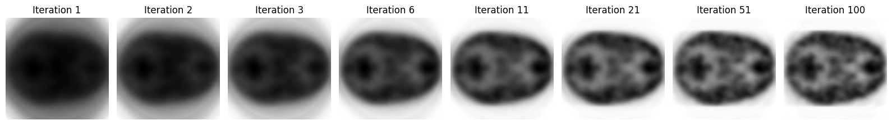

# PET Reconstruction

**Comparing direct inversion, filtered back-projection and iterative MLEM.**

This project models PET acquisition as a linear system and explores how reconstruction behaves with noise-free and noisy sinograms. Its central question is how iterative reconstruction can recover structure while avoiding excessive noise amplification.

[Open the notebook](pet_reconstruction.ipynb) · [All projects](../README.md)

## Methods

| Method | Role in the project |
| :--- | :--- |
| Forward system matrix | Project individual image-basis pixels with `skimage.transform.radon` |
| Direct least squares | Solve the linear model with `numpy.linalg.lstsq` |
| MLEM | Implement multiplicative expectation-maximization updates with a positive initial estimate |
| Filtered back-projection | Compare against the `skimage.transform.iradon` ramp-filter baseline |
| Iteration analysis | Track projection residuals and inspect image evolution |

For a single slice, the forward model is $g = Af$. The full system matrix has 15,660 rows and 7,569 columns. Arrays are flattened and reshaped in Fortran order to preserve the supplied indexing convention.

MLEM estimates image intensities using a Poisson measurement model. The squared projection residual shown in the notebook is a diagnostic, not the Poisson log-likelihood that defines the MLEM objective.

## Results

### Noise-free data

The saved sequence shows structures emerging from an initially smooth reconstruction.

### Noisy data

Later iterations display stronger noise texture. This illustrates why visual quality and agreement with noisy measurements need to be assessed separately.

## Run

Install the [shared requirements](../requirements.txt), put `PETdata.mat` in this folder and open `pet_reconstruction.ipynb` in Jupyter. `G` and `G_noisy` each have shape 87 × 180 × 26.

The notebook first uses a smaller 44-bin example. Full matrix construction performs a large number of basis-image projections. The dense `float32` matrix alone occupies approximately **452 MiB**, and least-squares solving requires additional memory and substantial computation. Full execution can therefore be slow. Saved notebook outputs can be inspected immediately without recomputation.

Generated matrices and intermediate `.npy` files are ignored by Git.

## Interpretation and limitations

The saved coursework reports an optimum of eight iterations, but the noise-free reference uses slice 10 while the later noisy reconstruction uses slice 15. Consequently, that comparison does not establish a valid stopping optimum for a matched slice. The README intentionally makes no numerical stopping recommendation; see [review notes](../docs/REVIEW_NOTES.md#pet).

The model represents geometry only. It does not implement attenuation, scatter or detector-efficiency corrections. The least-squares implementation is a direct inversion baseline, not unfiltered back-projection. Radon and inverse-Radon operations are supplied by scikit-image; the MLEM update code is implemented in the notebook.

**Joint work:** Neo Barrdahl and a project partner developed all code together for EEN180, Chalmers University of Technology.
